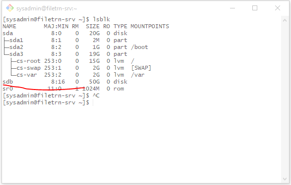
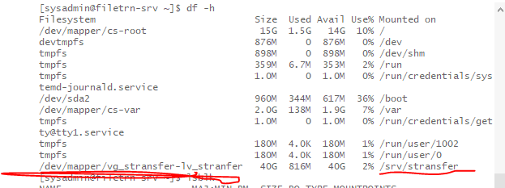

# Day 1 - 2026-10-05 (Monday)

Project: **Staff Transfer Platform**
Server: `filetrn-srv.sanimabank.com` / `192.168.137.150`

## Goal for today
Understand the server baseline, set up the project repo, and prepare dedicated storage for stransfer data.

## Server baseline
| Item | Value |
|---|---|
| OS | CentOS Stream 10 (Coughlan) |
| Kernel | 6.12.0-225.el10.x86_64 |
| Platform | VMware VM |
| RAM | 1.8 GiB (2 GiB swap) |
| OS disk | `sda` 20G: `/` 15G (xfs), `/var` 2G (xfs), `/boot` 1G, swap 2G |
| Network | `ens33` 192.168.137.150/24 |
| SELinux | Enforcing (keep it on) |
| firewalld | active and enabled (keep it on) |

## Done
- [x] Collected baseline (`hostnamectl`, `lsblk`, `df -hT`, `free -h`, `getenforce`, firewalld status)
- [x] Decided not to work as root; using user `sysadmin`
- [x] Confirmed `sysadmin` is in groups `admins` and `wheel` (sudo works through `wheel`)
- [x] Created project skeleton and git repo: `ansible/ portal/ scripts/ docs/ samples/`
- [x] Added `docs/` for journal and images, plus README
- [x] Added second disk `sdb` (50G) in VMware; needed a reboot before `lsblk` showed it

## Decisions and reasons
| Decision | Reason |
|---|---|
| Work as `sysadmin`, use `sudo` only when needed | Safer than root, `sudo` logs privileged commands (audit trail), cleaner file ownership |
| Transfer data in `/srv/stransfer` | `/srv` is the standard Linux location for data served to the network |
| Separate disk for `/srv/stransfer` | A full stransfer disk must not crash `/` (SSH, logs, Samba, portal). Gives accurate storage numbers and easy growth |
| LVM, using 80% of the VG | Keeps 20% free for `lvextend` or snapshots later |
| XFS (not ext4) | Distro default. Clients never see the filesystem; they only see SMB. Age of AD/PCs does not affect this choice |
| Keep SELinux Enforcing and firewalld on | Configure them properly instead of disabling them |

## Storage commands (run as sysadmin)
```bash
# confirm sdb is empty first
sudo wipefs /dev/sdb; sudo blkid /dev/sdb

# LVM
sudo pvcreate /dev/sdb
sudo vgcreate vg_stransfer /dev/sdb
sudo lvcreate -l 80%VG -n lv_stransfer vg_stransfer


# filesystem and mount
sudo mkfs.xfs /dev/vg_stransfer/lv_stransfer
sudo mkdir -p /srv/stransfer 
sudo mount /dev/vg_stransfer/lv_stransfer /srv/stransfer


# permanent mount by UUID, then test it

lsblk -f | grep vg_stransfer-lv_stranfer
sudo vi /etc/fstab
add UUID="XXXXXXXXXXXX"  /srv/stransfer  xfs   defaults 0 0
sudo systemctl daemon-reload 
sudo mount -a

# verify
lsblk
df -hT /srv/stransfer
vgs
tail -n 1 /etc/fstab
```

Status checklist (tick as you complete):
- [ ] LVM volume created (`vg_stransfer` / `lv_stransfer`)
- [ ] XFS formatted
- [ ] Mounted at `/srv/stransfer`
- [ ] fstab entry added and tested with `mount -a`
- [ ] Verified with `df -hT /srv/stransfer` and `vgs`

## Design summary
```
Admin (browser) -> Nginx -> Flask Portal -> SQLite (stransfers, audit_log)
                                |
                                v  validated stransfer.yml (never raw shell)
                          Ansible Runner -> create / purge folders, ACLs
                                ^
                     systemd timer (nightly 7-day expiry)

/srv/stransfer/<username>/  <- Samba (SMB3) <- Staff PCs
```

Lifecycle:
`UPLOADED -> VALIDATED -> APPROVED -> ACTIVE -> EXPIRING (<24h) -> EXPIRED -> PURGED`
(`REJECTED` if validation fails). Every state change is written to the audit log.

Server layout:
- `/srv/stransfer/` staff data (own LVM disk)
- `/opt/staff-stransfer/` deployed code
- `/var/log/staff-stransfer/` app and audit logs

## Roadmap
| Phase | Goal |
|---|---|
| 1 | Server baseline, repo, storage (today) |
| 2 | Samba share, per-user folders, ACLs |
| 3 | Python: read and validate Excel, generate `stransfer.yml` |
| 4 | Ansible: create and remove folders, 7-day purge timer |
| 5 | Flask portal: upload, dashboard, storage, audit log |
| 6 | AD/Kerberos, GPO drive mapping, SELinux and firewalld hardening |

## Open questions
- Windows version on staff PCs (`winver`)? Needed to decide the SMB protocol minimum. Do not enable SMB1.
- AD domain functional level? Check before Phase 6.
- Is there an AD lab, or do we start with local Samba users? (Plan: local users for Phases 1-5, AD in Phase 6)

## Notes and limits
- Dashboard will show folder size, file count and last activity. Samba gives no true "% stransferred" value, so we will not fake one.
- Never commit passwords, API keys, real employee data or internal screenshots. Add `.gitignore` entries as needed.

##images



## Next (Day 2)
1. Finish and verify storage at `/srv/stransfer`
2. Install Samba, create a test share
3. Set SELinux contexts and open the firewall for SMB only
4. Test access from a Windows PC
