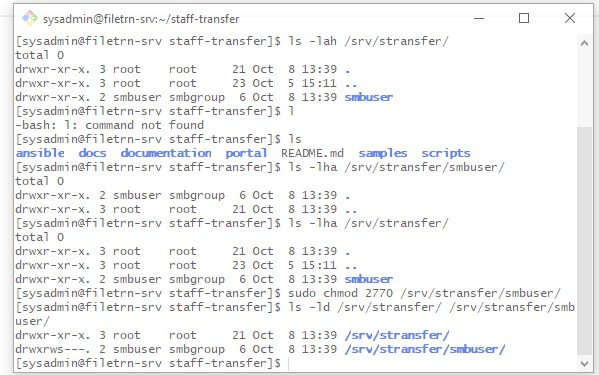
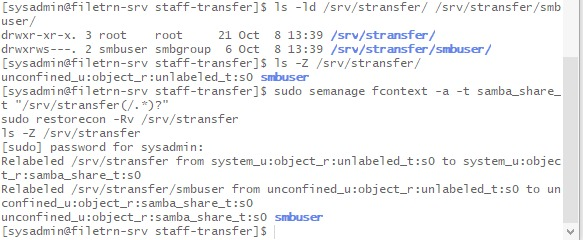
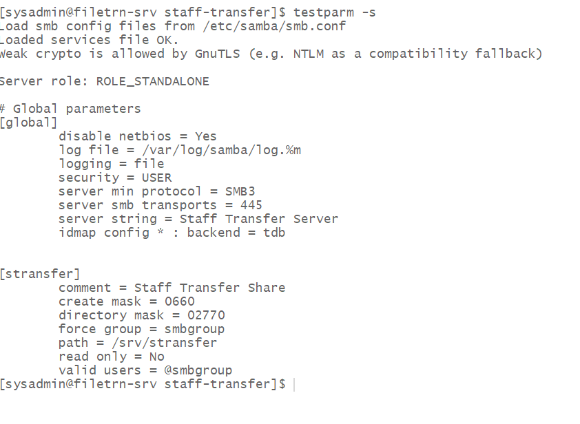
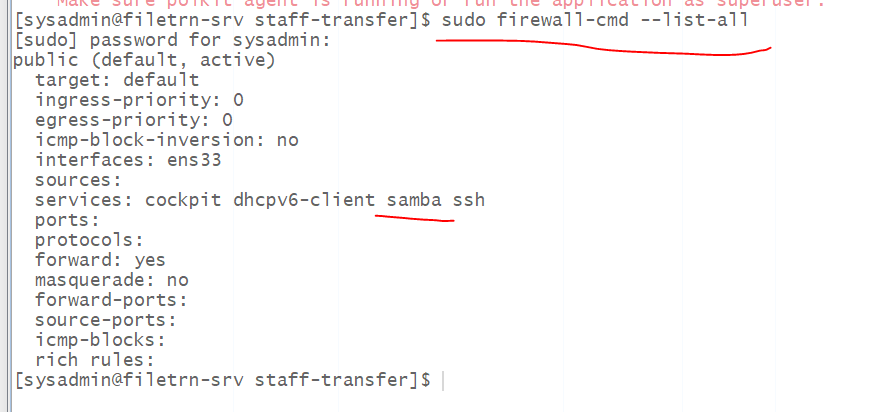
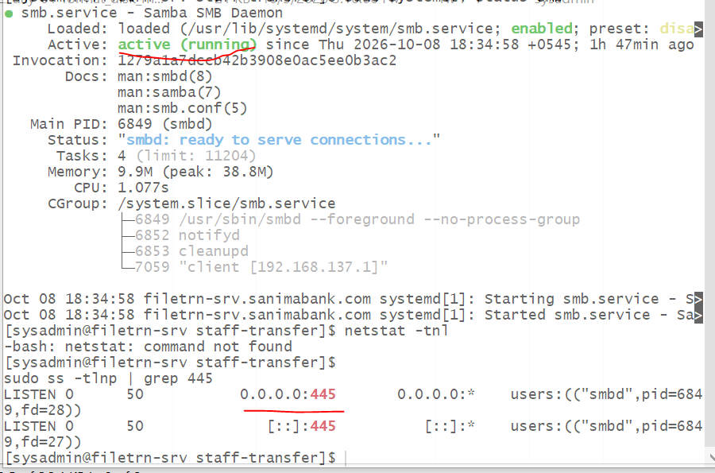
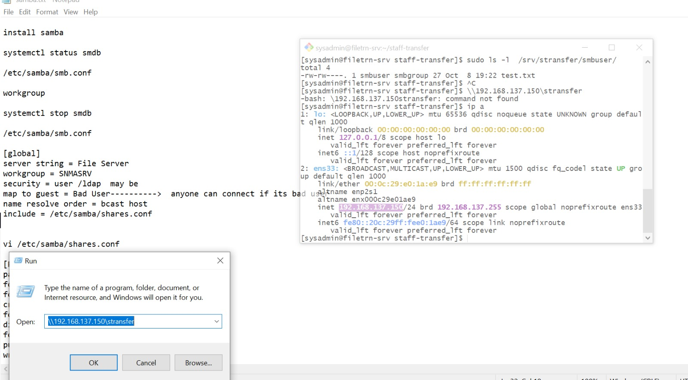
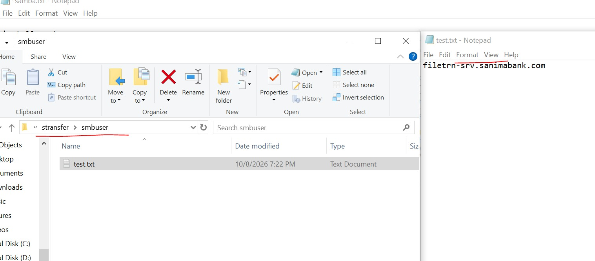

# Day 02 — 2026-10-08

## Goal
Install Samba and expose `/srv/stransfer` over SMB3 using a local test user.
AD/Kerberos is deferred to Phase 6.

## Baseline (from Day 1)
- SELinux: Enforcing
- firewalld: active
- Share root: `/srv/stransfer` (XFS, 40 GB LVM)

## Identity model
| Item  | Value |
|-------|-------|
| Group | `smbgroup` (system group) |
| User  | `smbuser` (system user, shell `/bin/false`, no home directory) |

Rationale: a dedicated service account for the lab share, to be replaced by AD users in Phase 6.

## Folder layout
```
/srv/stransfer              root:root       0755   (share root, admin-only)
└── smbuser                 smbuser:smbgroup 2770  (test folder)
```
- `2` (setgid): new files and folders inherit group `smbgroup`
- `770`: owner and group have full access; others have none


## SELinux
```bash
sudo semanage fcontext -a -t samba_share_t "/srv/stransfer(/.*)?"
sudo restorecon -Rv /srv/stransfer
ls -Zd /srv/stransfer
```
- SELinux stays Enforcing; no boolean was changed.
- Used `semanage fcontext` instead of `chcon` because the label is saved in policy and survives `restorecon` and full relabels.



## Samba config (`/etc/samba/smb.conf`)
Original backed up to `smb.conf.orig`.

```ini
[global]
   workgroup = WORKGROUP
   server string = Staff Transfer Server
   security = user
   map to guest = never
   server min protocol = SMB3
   server max protocol = SMB3
   disable netbios = yes
   smb ports = 445
   log file = /var/log/samba/log.%m
   max log size = 5000
   logging = file

[stransfer]
   comment = Staff Transfer Share
   path = /srv/stransfer
   browseable = yes
   read only = no
   valid users = @smbgroup
   force group = smbgroup
   create mask = 0660
   directory mask = 2770
```
Validated with `testparm -s` ("Loaded services file OK").



## Samba user
```bash
sudo smbpasswd -a smbuser
sudo smbpasswd -e smbuser
sudo pdbedit -L
```

## Firewall
```bash
sudo firewall-cmd --permanent --add-service=samba
sudo firewall-cmd --reload
sudo firewall-cmd --list-services
```


## Service
```bash
sudo systemctl enable --now smb
systemctl status smb
sudo ss -tlnp | grep 445
```
- On RHEL/Rocky/Alma the service is `smb`. (`smbd` is the Debian/Ubuntu name.)
- `nmb` is not needed because NetBIOS is disabled.


## Verification
- `smbclient -L localhost -U smbuser` → `stransfer` visible
- `smbclient //localhost/stransfer -U smbuser` → `put test.txt` into `smbuser/` succeeded
- `ls -l /srv/stransfer/smbuser` → file owned `smbuser:smbgroup`, mode `0660`
- Windows `\\192.168.137.150\stransfer` → accessible with credentials



## Problems faced and solved

### 1. `testparm` error: "Ignoring invalid value ... for parameter 'security'"
- **Symptom:** `Error loading services.`
- **Cause:** I had comments at the end of config lines (`security = user # comment`). Samba treats everything after `=` as the value, so end-of-line comments are not allowed.
- **Fix:** Put comments on their own line, or remove them.
```bash
  grep -n '=.*#' /etc/samba/smb.conf              # find offending lines
  sudo sed -i.bak 's/[[:space:]]*#.*$//' /etc/samba/smb.conf   # strip all comments
```
  In vi: `Esc`, then `:%s/\s*#.*//`.

### 2. `Unit smbd.service does not exist`
- **Cause:** The systemd service name differs by distro. The program is `smbd` everywhere, but the service is `smb` on RHEL-family and `smbd` on Debian/Ubuntu.
- **Fix:** `sudo systemctl enable --now smb`

### 3. `NT_STATUS_ACCESS_DENIED` when writing to the share root
- **Symptom:** Login and listing worked, but `put` failed in `\\server\stransfer`.
- **Diagnosis:** `ls -ld /srv/stransfer` showed `drwxr-xr-x root:root`. `smbuser` is "other", so it can read but not write. Group membership was fine (`id smbuser`) and `ausearch -m avc` returned nothing, so SELinux was not the cause.
- **Fix/decision:** Writes go inside the per-user folder `/srv/stransfer/smbuser` (`2770`). The share root stays `root:root 0755` so users cannot create top-level folders.
  (Alternative: `chgrp smbgroup /srv/stransfer && chmod 2770 /srv/stransfer` lets the group write at the root.)

### 4. `chcon` vs `semanage fcontext`
- `chcon` changes the label immediately but is **temporary**. It is lost on `restorecon` or a full relabel.
- `semanage fcontext` + `restorecon` stores the rule in policy, so it is **permanent**. Use this on servers.
- The type name is `samba_share_t`.

### 5. Why `sudo tee` instead of `vi`
- `sudo echo "x" > file` fails because the `>` redirection runs as the normal user, not root.
- `echo "x" | sudo tee file` works because `sudo` applies to the writer.
- For a one-off manual edit, `sudo vi /etc/samba/smb.conf` is fine. `tee` is for scripts and copy-paste blocks.
- Do not run the sample `...` placeholder literally; it would overwrite smb.conf with an incomplete file.

### 6. Output that looks wrong but is normal
- `testparm -s` hides default values and renames some (`smb ports` is shown as `server smb transports`).
- "Weak crypto is allowed by GnuTLS" is a general warning, not an error.
- `SMB1 disabled -- no workgroup available` is expected because SMB1 and NetBIOS are off.
- `IPC$` is a hidden system share that Samba always creates.

### 7. vi mistakes
- Quit without saving: `Esc`, then `:q!` (one colon).
- Save and quit: `Esc`, then `:wq`.
- Use `sudo vi`, or the file opens read-only.

### 8. Why the per-user folder uses `2770` and `smbuser:smbgroup`
- Owner `smbuser` manages the folder; group `smbgroup` can read and write.
- `770` blocks everyone else.
- Setgid (`2`) keeps new files in `smbgroup` instead of the creator's personal group.
- Files created over Samba get the right owner, group, and mode automatically (`force group`, `create mask`, `directory mask`). A later `chown` or `chmod` is only needed for files created locally as root (`sudo cp`, `sudo mkdir`).

## Lessons learned
A Samba share needs five things to work:
1. Linux user exists
2. Samba password exists (separate DB; Samba does not reuse `/etc/shadow`)
3. POSIX permissions on the whole path, including setgid on the folder (the share root needs to allow the user too)
4. SELinux context `samba_share_t` on the path
5. firewalld allows TCP 445 (service `samba`)

Also:
- Disabling NetBIOS removes the need for `nmb.service`.
- No end-of-line comments in `smb.conf`.
- Always run `testparm -s` before restarting Samba.
- Troubleshooting order: Linux permissions → `id user` → `ausearch -m avc -ts recent` → `/var/log/samba/log.<client>`.

## Known limitations (to fix in Phase 6)
- Current setup uses one shared group (`smbgroup`) with `force group`, so every group member can access every folder. This is **not private**.
- For personal staff files, the AD design should use:
  - folder owner = `DOMAIN\user`, mode `0700`
  - no `force group`; `create mask = 0600`, `directory mask = 0700`
  - `hide unreadable = yes`
  - AD branch/department groups only for shared folders
  - `security = ads`, `winbind`, `idmap config` lines, and `realm join`
- Prerequisites to collect: domain and NetBIOS name, join account, AD group names, AD DNS on this server, time sync (chrony) with the domain controllers.
- Consider `full_audit` logging and backups for the bank's audit requirements.

## Next
- Phase 3: Python validator (Excel → validated YAML).
