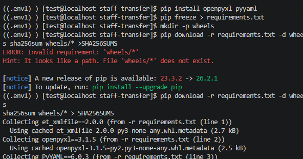
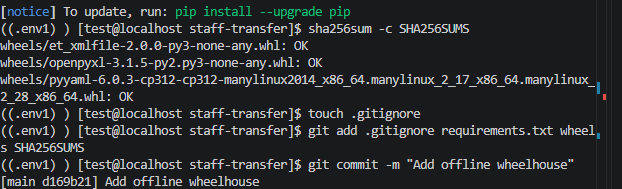
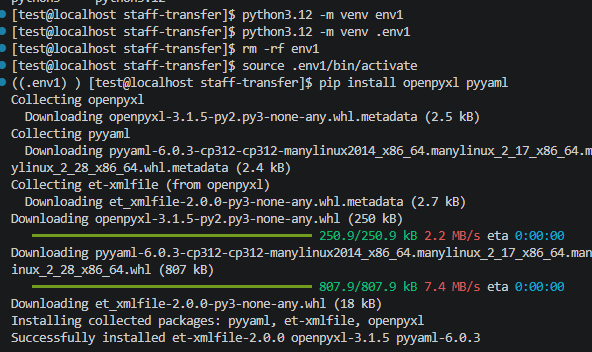

# Day 03 - 2026-10-09 (updated 2026-10-20)

## Goal
1. Get Python dependencies onto the office VM despite the firewall.
2. Add a validation layer between Excel input and Ansible output.
   The validator turns messy human input into trusted YAML, or refuses the file.
3. Get a usable Python editor for the office VM without installing anything
   on the office PC.

---

## Part 1: Problem - pip could not download packages

### Symptom
`pip install --upgrade pip` (and every other package download) failed on
filetrn-srv with `ConnectionResetError(104, 'Connection reset by peer')`.

### Diagnosis
- TLS handshake and package metadata worked; the package file download was reset.
- `ping -M do -s 1472 pypi.org` passed, so MTU was not the cause.
- `curl -4` also failed, so IPv6 was not the cause.
- The sdist (.tar.gz) and a tiny pure-Python wheel (requests, 73 kB) failed too,
  so it was not file type, size, or embedded .exe files. (My early theory about
  executables was wrong.)
- A GitHub tarball downloaded fine.
- Conclusion: the office Palo Alto firewall resets downloads from
  files.pythonhosted.org. This is a network policy, not a pip fault.

### Decision
Do not bypass the firewall (no VPN, tunnels to the internet, Wi-Fi dongle,
VS Code dev tunnels, or moving the VM to a personal network). Use an
approved path instead.

### Solution - offline wheelhouse via GitHub
- Home WFH laptop runs a lab VM (same OS family as the office VM, Python 3.12),
  connected with VS Code Remote-SSH.
- In the lab: install packages, `pip freeze > requirements.txt`,
  `pip download -r requirements.txt -d wheels`,
  `sha256sum wheels/* > SHA256SUMS`.
  
  
- Commit and push to the private GitHub repo `staff-transfer`.
- At the office: `git pull`, `sha256sum -c SHA256SUMS`,
  `pip install --no-index --find-links=wheels -r requirements.txt`.
  
- Result: openpyxl 3.1.5, et_xmlfile 2.0.0, PyYAML 6.0.3 installed with no
  internet access. All three checksums OK.

---

## Part 2: Environment

- Office VM: filetrn-srv, 192.168.137.150, venv at ~/staff-transfer/.venv
- Home lab VM: venv at .env1 (both venvs are in .gitignore)
- Repo layout: ansible/ config/ docs/ documentation/ portal/ samples/ scripts/
  wheels/ requirements.txt SHA256SUMS .gitignore
- Dependencies: openpyxl, pyyaml (pinned in requirements.txt, wheels in wheels/)
- Test users created earlier: ashis.maharjan,pradip.dhamala (local, no shell, smbgroup)
- Never commit: passwords, keytabs, AD/Kerberos configs, real staff data.
  Check screenshots in documentation/images for internal names before pushing.

### Git notes
- `git clone` already sets up `origin` and branch tracking; `git remote add`
  is only needed after `git init`.
- Always `git pull` before editing on either machine.
- Empty folders are not tracked; use .gitkeep.
- Set a proper identity on both machines (`git config --global user.name/email`).

---

## Part 3: Excel contract (changed from the first draft)

Username | Employee ID | Source Unit | Destination Unit | Start Date | Retention Days

- Renamed Branch to Unit: branches, extension counters and departments
  (e.g. biratnagar, maitidevi, sme, hr) are treated as one flat list.
- The valid unit list lives in config/units.yaml, not in the code.

## Part 4: Validator (scripts/validate_transfers.py)

- Loads the workbook with openpyxl (data_only=True), finds columns by name.
- Rejects the file if a required column is missing.
- Keeps the Excel row number in `_row` so errors can say "row 6".
- Validates each row:
    * username regex ^[a-z][a-z0-9.]{2,31}$ (dots allowed, e.g. ashis.maharjan)
    * existence check through user_exists()
    * Employee ID: 1-6 digits (converted with str() first, Excel may give a number)
    * source and destination in VALID_UNITS (from config/units.yaml), not equal
    * start date parsed by parse_date (datetime cell or YYYY-MM-DD string)
    * retention integer, MIN 1 to MAX 7
- Batch check: duplicate usernames in the same file (uses a set).
- Computes expiry_date = start_date + retention_days.
- Writes the YAML only for valid rows, without `errors` and `_row`.
- Exit codes: 0 all valid, 1 data errors, 2 usage error.

### Design decisions
- Collect all errors; do not stop at the first.
- Rules live at the top of the file / in config, not scattered in code.
- safe_dump so only plain data reaches Ansible.
- user_exists() is the single place to change for AD.
    Lab: CHECK_USERS = False (lab has no AD users, valid rows would all fail)
    Office VM with test users: can set True
    Phase 6: replace the body with an LDAP/AD lookup
- No group-membership check (source/destination): decided it is unnecessary.
- One validator, two producers: bulk Excel and (Phase 4) a single-user form
  will both call validate_row.
- Output goes to a project folder (output/, chmod 700, in .gitignore),
  not /tmp, because it will contain staff data. /tmp was used only for tests.

### Fixes compared with the first version
- Old username regex rejected valid names containing a dot.
- Old branch codes (KTM, PKR...) did not match the real names used.
- No minimum retention.
- The "duplicate" sample row had no matching first row.
- make_sample.py paths are now relative to the script, so it works from
  any directory.

### Verification
- First run produced valid YAML (3 transfers, expiry dates correct,
  e.g. 2026-10-06 + 7 = 2026-10-13).
- That run used the old sample. With the new make_sample.py the expected
  result is 4 valid, 3 invalid (duplicate ram01, badone, spacey), exit code 1.
  TODO: rerun make_sample.py and confirm.

---

## Part 5: Python and shell concepts learned
- `source` runs a file in the current shell; normal execution uses a child
  shell (why venv `activate` must be sourced, and why `exit` in a sourced
  file closes the terminal).
- `__name__ == "__main__"` runs main() only when the file is run directly.
- Shebang `#!/usr/bin/env python3`; needs chmod +x to run as ./script.
- `sys.argv` holds command-line arguments; `sys.exit(n)` returns an exit code.
- f-strings, list/dict comprehensions, `with open(...)`.
- set vs list vs dict: a set is the best fit for "have I seen this before?".
- Wheel = Python's standard package file; SHA256SUMS = checksum (detects
  corruption or tampering), not encryption.
- Containers do not remove the offline-transfer problem and are a poor fit
  for Samba/AD/Kerberos services.

---

## Part 6: Dev environment - code-server on the VM, reached by SSH tunnel

### Problem
The office PC has no VS Code and downloads are restricted, so nothing can be
installed on the PC.

### Setup
- code-server 4.141.0 runs on the office VM as user `sysadmin`.
- It listens on 127.0.0.1:8787 only (confirmed with `ss -tnlp`;
  only 22 and 445 are open to the network).
- MobaSSHTunnel on the office PC forwards local port 8787 to
  127.0.0.1:8787 on sysadmin@192.168.137.150:22.
- The browser on the office PC opens http://localhost:8787
  (plain http; code-server is not serving HTTPS).
- The login password is stored in ~/.config/code-server/config.yaml on the VM
  (never write it in the journal or the repo).

Traffic path:
office browser -> localhost:8787 -> SSH tunnel -> VM 127.0.0.1:8787 -> code-server
Only a normal SSH connection crosses the office network.

### Start procedure (after every PC restart)
1. SSH to the VM and run:
   `cd ~/staff-transfer && code-server --bind-addr 127.0.0.1:8787`
   (keep that terminal open, or use tmux).
2. In MobaSSHTunnel press PLAY on the 8787 row (it does not auto-start).
3. Open http://localhost:8787 and enter the password.
4. Open folder ~/staff-transfer, then Ctrl+Shift+P > Python: Select Interpreter
   > .venv/bin/python so Pylance sees openpyxl and yaml.
5. When finished, press Ctrl+C in the code-server terminal.

### Troubleshooting log
- Browser could not connect, but code-server on the VM was healthy
  (`curl -I http://127.0.0.1:8787` on the VM returned 302 to /login).
- Cause: the tunnel was not started after the reboot.
- Test from the PC side (MobaXterm local terminal): the same curl command
  must return 302. "Failed to connect" means the tunnel is not running.
- Forgot the login password: read it with
  `cat ~/.config/code-server/config.yaml`, or edit that file and restart.

### Security rules for this setup
- Keep bind-addr at 127.0.0.1; never 0.0.0.0; never open 8787 in firewalld.
- Run as sysadmin, never root; use a strong, unique password
  (it gives a terminal on the server).
- Run it only when needed.
- Do NOT install code-server on the real RHEL server. Develop in the VM,
  push to GitHub, `git pull` on the real server.
- Tell the network/security team about this setup.
- Extensions come from Open VSX; for blocked ones, install a downloaded
  .vsix file ("Extensions: Install from VSIX").

---

## Terminology
- AD       = the directory (who exists)
- LDAP     = the query protocol for the directory
- Kerberos = the authentication protocol used by AD

## Next
- Rerun sample and confirm 4 valid / 3 invalid.
- Small own edits: change MAX_RETENTION_DAYS, add a unit, show
  "duplicate of row N" in the duplicate message.
- Turn day-01/day-02 steps into an Ansible playbook that uses the validator's YAML.
- Message the network team: PyPI mirror, GitHub wheelhouse, code-server tunnel,
  and the real server's RHEL/Python version.
- Phase 4: Flask portal (upload Excel, single-user form, dashboard, audit).
- Phase 6: AD join, Kerberos, replace user_exists() with a real lookup,
  optionally sync config/units.yaml from AD.
